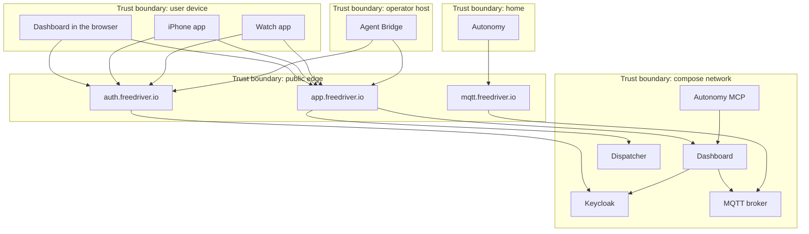

# System map

One diagram of the running system. Each box group is a trust boundary.

The dashboard, the iPhone and the Watch sign in at Keycloak on `auth.freedriver.io` and call the dashboard on `app.freedriver.io`. Autonomy at home reaches the MQTT broker through `mqtt.freedriver.io`. The Agent Bridge runs on the operator host, outside the compose network. It calls the dispatcher through `app.freedriver.io` and signs in at `auth.freedriver.io`. The dispatcher does not call the operator host. The dispatcher host API is the path Caddy routes for that host.
